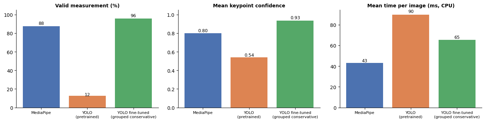

# Baseline Workflows vs Fine-Tuned YOLO — Comparison Record

Record of the three-workflow comparison (MediaPipe, pretrained YOLO, fine-tuned YOLO) so it can be reused when comparing other tested models. Screening-support research only — nothing here is a diagnosis, a Cobb angle, or an angle-of-trunk-rotation measurement.

Visual version: section 7 of [`grouped_workflow_comparison.ipynb`](../grouped_workflow_comparison.ipynb).

## 1. What each workflow is

| Workflow | What it is | Trained on this data? | Produces |
| --- | --- | --- | --- |
| MediaPipe | Off-the-shelf pose model (33 body landmarks) | No | Shoulder and hip landmarks, a trunk-axis angle |
| YOLO pretrained | `yolov8n-pose` with COCO weights (17 body keypoints) | No | COCO shoulder and hip keypoints, a trunk-axis angle |
| YOLO fine-tuned | `yolov8n-pose` fine-tuned on the scoliosis keypoints | Yes | 12 spine keypoints, normal/scoliosis class, anatomy-aware geometry |

Only the fine-tuned model predicts a class and spine geometry, so **classification can only be compared between fine-tuned models**.

## 2. Two sets of results — keep them apart

The two test sets are different images, so the rows are **not** interchangeable.

| Results | Test set | Where | Status |
| --- | --- | --- | --- |
| **Grouped split** (use these) | 24 images (12 normal, 12 scoliosis), no photo shared with training | `*_scoliosis_grouped_split_test*.csv` | Current |
| Old public split | 19 images (14 normal, 5 scoliosis) | `*_scoliosis_test*.csv`, `comparison_summary.csv` | Historical/debug (see below) |

### 2a. Grouped split — current (24 images)

Run 2026-10-10. MediaPipe and pretrained YOLO were re-run on the grouped test folder; the fine-tuned row is the grouped conservative-augmentation model (trained on the grouped train/valid split). Summary file: `Data/Processed/comparison/comparison_grouped_baselines.csv`.

| Metric | MediaPipe | YOLO pretrained | YOLO fine-tuned (grouped, conservative) |
| --- | --- | --- | --- |
| Pose found | 87.5% (21/24) | 100% (24/24) | 95.8% (23/24) |
| Valid measurement | **87.5%** | **12.5%** | **95.8%** |
| Normal images with a valid measurement | 9 / 12 | 0 / 12 | 11 / 12 |
| Scoliosis images with a valid measurement | 12 / 12 | 3 / 12 | 12 / 12 |
| Mean keypoint confidence | 0.798 | 0.540 | 0.935 |
| Mean missing keypoints | 0.50 | 1.92 | 0.38 |
| Mean time per image (CPU) | 43 ms | 90 ms | 65 ms |
| Predicts normal/scoliosis | no | no | yes |
| Classification accuracy | n/a | n/a | 0.609 (14 of 23 predicted) |
| Scoliosis recall | n/a | n/a | 5 / 12 |



### 2b. Old public split — historical (19 images)

From the original comparison (2026-09-13, file `Data/Processed/comparison/comparison_summary.csv`). The fine-tuned row there is the **first** fine-tuned model, trained on the old split, and is affected by data leakage (near-identical photos shared between its train and test sets). The MediaPipe and pretrained rows are unaffected by leakage, but they were measured on a different, smaller set of images.

| Metric | MediaPipe | YOLO pretrained | YOLO fine-tuned (old split, leaked) |
| --- | --- | --- | --- |
| Valid measurement | 63.2% | 5.3% | 84.2% |
| Mean keypoint confidence | 0.579 | 0.463 | 0.712 |
| Mean missing keypoints | 1.47 | 2.16 | 1.42 |
| Mean time per image (CPU) | 48 ms | 272 ms | 234 ms |
| Normal / scoliosis detection rate | 0.643 / 0.600 | 0.071 / 0.000 | 0.786 / 1.000 |
| Classification accuracy / scoliosis recall | n/a | n/a | 0.750 / 1.000 |

The baselines' rates move a lot between the two test sets (MediaPipe 63% → 88%, pretrained 5% → 12.5%), which shows how sensitive these numbers are to which few images are used. Use the grouped-split table for any current comparison, and don't compare an old-split row with a grouped-split row.

## 3. Reading the comparison

- **Fine-tuning clearly helps detection.** The pretrained YOLO finds a person in every image (pose found 100%) but its COCO shoulder and hip keypoints are not confident on bare backs, so only 3 of 24 images give a usable measurement. MediaPipe gets 21 of 24, and the fine-tuned model 23 of 24.
- **"Valid measurement" is defined differently per workflow** (MediaPipe: 4 shoulder/hip landmarks visible; pretrained YOLO: 4 COCO keypoints confident; fine-tuned: all 9 spine keypoints confident). Read it as "did this workflow produce a usable measurement of its own kind", not as like-for-like accuracy. Keypoint confidence is also each model's own confidence, not correctness.
- **The advantage is in coverage, not in screening accuracy.** The fine-tuned model's classification on the grouped test is weak (accuracy 0.61, scoliosis recall 5 of 12), and its keypoints, though plausible, are not accurate against the ground truth (see `docs/interim_report.md`). MediaPipe is the fastest.
- **Timing is indicative only.** CPU timings from a single pass on a shared machine; the pretrained YOLO figure includes warm-up.
- Primary angles are **not comparable** across workflows: MediaPipe and pretrained YOLO use a shoulder-to-hip proxy, the fine-tuned model a direct spine axis.

## 4. Files and how to reproduce

| What | File |
| --- | --- |
| Grouped-split per-image results | `Data/Processed/comparison/mediapipe_scoliosis_grouped_split_test.csv`, `yolo_pretrained_scoliosis_grouped_split_test.csv`, `yolo_finetuned_scoliosis_grouped_split_test_grouped_conservative.csv` (each with a `.meta.json` recording dataset, split and weights) |
| Grouped-split summary | `Data/Processed/comparison/comparison_grouped_baselines.csv` |
| Old-split per-image results | `mediapipe_scoliosis_test.csv`, `yolo_scoliosis_test.csv`, `yolo_finetuned_scoliosis_test.csv` |
| Old-split summary and figures | `comparison_summary.csv`, `fig_*.png` |

```bash
# Re-run the baselines on the grouped test split (seconds; no training)
python src/Evaluation/run_evaluation.py --model mediapipe       --data-yaml Data/Processed/scoliosis_grouped_split/scoliosis_grouped_split.yaml --split test
python src/Evaluation/run_evaluation.py --model yolo_pretrained --data-yaml Data/Processed/scoliosis_grouped_split/scoliosis_grouped_split.yaml --split test

# Compare them with a fine-tuned model (swap in any grouped-split model's CSV)
python src/Evaluation/compare_workflows.py \
    --mediapipe-csv  Data/Processed/comparison/mediapipe_scoliosis_grouped_split_test.csv \
    --pretrained-csv Data/Processed/comparison/yolo_pretrained_scoliosis_grouped_split_test.csv \
    --finetuned-csv  Data/Processed/comparison/yolo_finetuned_scoliosis_grouped_split_test_<tag>.csv \
    --out-name grouped_baselines
```

When the grouped default-augmentation baseline is trained and evaluated (tag `grouped_default`), compare it with the conservative model using `compare_original_vs_cleaned.py` (command in the README). The two baselines here do not need to be re-run for that.
