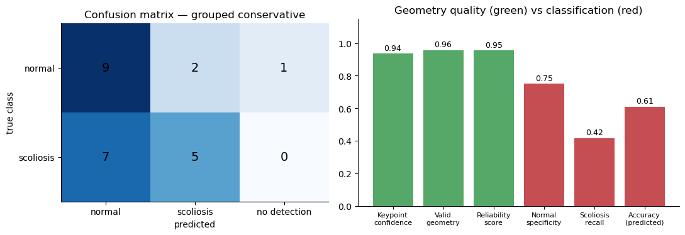
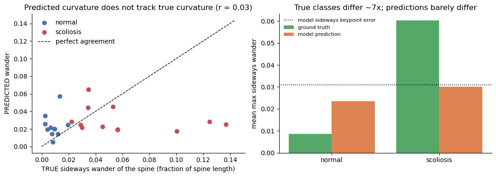
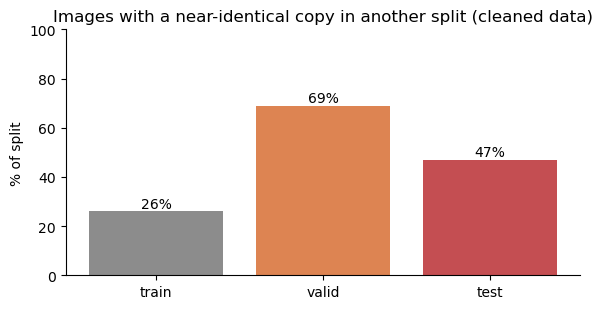
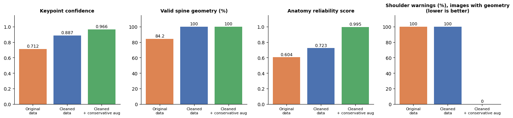
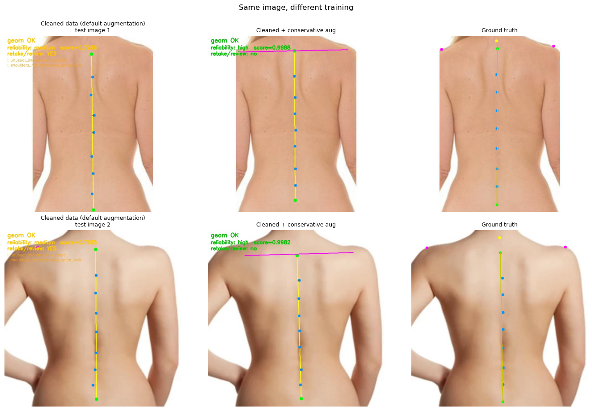

# Interim Report — YOLO Spine-Keypoint Pipeline for Scoliosis Screening Support

**Project:** Kidzonia (CDE4301) — AI-assisted scoliosis **screening support**
**Scope:** non-diagnostic. Nothing in this report is a diagnosis, a Cobb angle, or a true angle-of-trunk-rotation measurement.
**Evidence:** charts, tables and example images are in [`workflow_comparison.ipynb`](../workflow_comparison.ipynb), a **historical/debug notebook** (old split, affected by data leakage; not for final performance claims). The **final, leakage-free results** are in [`grouped_workflow_comparison.ipynb`](../grouped_workflow_comparison.ipynb).

> **Status of the results.** The headline result below is from a model **trained on the photo-grouped split and evaluated on its test folder**. Every number in sections 7–8 was measured on the **old public split**, which shares near-identical photos between train, valid and test (section 4); they are **historical/debug results**, useful for seeing what changed between models, not final performance, and the headline shows how much they flattered the classifier.

## Headline: grouped-split results (leakage-free)

One model so far: cleaned data, conservative augmentation (no horizontal flip), trained on the grouped train/valid split and evaluated on the grouped test split (24 images: 12 normal, 12 scoliosis, from 14 photo groups). It is a **single training run with no grouped baseline yet**, so it cannot say whether conservative augmentation helped.

| Measure | Grouped test |
| --- | --- |
| Mean keypoint confidence | 0.94 |
| Images with `high` reliability | 23 of 24 (the other is the one missed detection) |
| Shoulder warnings | 0% |
| Keypoint error vs ground truth (fraction of spine length) | spine ≈ 5%, sideways ≈ 3%, shoulders ≈ 12% |
| True vs predicted sideways spine wander (normal → scoliosis) | truth 0.0085 → 0.060 (≈ 7×); predicted 0.023 → 0.030 (≈ 1.3×); correlation ≈ 0.03 |
| Classification accuracy | 0.61 (14 of 23 predicted images) |
| Scoliosis recall / normal specificity | **5 of 12** / 9 of 12 |

- **The model finds the spine but not its curve.** Keypoints are plausible and in the right neighbourhood, so the reliability score is near 1.0, but their sideways error is as large as the curvature signal, and predicted curvature is uncorrelated with the true curvature. **Reliability measures plausibility, not accuracy.**
- **Classification is weak.** 7 of the 12 scoliosis images were predicted as normal, and those come from only 3 photos, so the evidence is thinner than the count suggests. Missed scoliosis is the costly error for a screening tool.
- **The old split flattered classification.** The same recipe showed 0.84 accuracy and 5/5 scoliosis recall on the old test split (different test sets, so indicative only).
- **The 95% target is not met and is not claimed.**

## 1. Project overview

The wider system aims to support school-based scoliosis screening with low-cost camera captures and interpretable indicators. This report covers one component: a **fine-tuned YOLOv8 pose model** that finds 12 spine-related keypoints in a back photo, plus an **anatomy-aware layer** that checks whether those keypoints are trustworthy before any geometry is computed from them.

## 2. Problem statement

Off-the-shelf pose models do not locate the spine. On the same 19 test images, MediaPipe produced a usable measurement on about 63% and a pretrained COCO YOLO on about 5%, versus about 84% for the first fine-tuned model (these rates are defined differently per workflow, so they are indicative, not a strict ranking). Fine-tuning is therefore needed. Just as important is knowing **when not to trust** the output, so accuracy is always read together with reliability.

## 3. Proposed pipeline

1. Photo → YOLOv8-pose predicts 12 spine keypoints, with confidences, and a `normal` / `scoliosis` class.
2. Anatomy-aware checks test whether the keypoints are plausible for an upright back.
3. Transparent geometry features are computed (spine-axis tilt, shoulder line, lateral deviation, curve smoothness).
4. A rule-based reliability score and a **retake / review** flag describe measurement quality.

## 4. Dataset and cleaning

Public Roboflow scoliosis keypoint dataset (CC BY 4.0): 191 images, 12 keypoints each, labels from the dataset (not verified against X-ray).

| | Train | Valid | Test | Total |
| --- | --- | --- | --- | --- |
| Original | 135 | 37 | 19 | 191 |
| Cleaned | 128 | 36 | 19 | 183 |

Cleaning removed **8 images with objective defects** (5 empty label files, 3 with a visible keypoint outside the image). Hard-looking or unusual images were kept on purpose, because a screening model must be tested on realistic cases.

**Split-quality check** (`split_quality_check.py`) found problems that affect how far the test numbers can be trusted:

- The 183 images come from only about **118 distinct photos**; copies of the same photo appear in more than one split.
- **25 of 36 validation images and 9 of 19 test images** have a near-identical copy in another split. These copies carry different file hashes, so byte-level duplicate checks do not catch them.
- At least **two near-identical photos carry opposite labels** (normal vs scoliosis).
- The test set is small (19 images, 5 scoliosis) and its class mix (26% scoliosis) differs from train (56%).

As a result, validation and test metrics are **optimistic**, and a one-image change moves accuracy by about 5 points.

**Grouped re-split.** `create_grouped_split.py` builds a new split where every photo group (same filename before `.rf.`, or near-identical pixels) sits in exactly one split, assigned with a class-stratified grouped splitter. Four mixed-label photo groups (14 images) were excluded rather than guessed and are listed in the split's conflict report. The result is train 120 (59 normal / 61 scoliosis), valid 25 (12 / 13) and test 24 (12 / 12), and an independent check found no near-identical pair across splits. The test set is better balanced and has no photo overlap with training, but 24 images is still small (one image is about 4 points of accuracy). Models trained on the old split must be retrained on it; they are not valid on its test set.

## 5. YOLO fine-tuning setup

All models are `yolov8n-pose` fine-tuned from the same pretrained weights (100 epochs max, early-stopping patience 20, image size 640, batch 8, seed 0). The architecture and loss are unchanged. These settings are now command-line options of `train_yolo_scoliosis.py`, together with an `--augment-profile`:

- `default_yolo` — Ultralytics' own augmentation (previous behaviour).
- `conservative` — simple synthetic variation from the available photos: small rotation (up to 5°), shift (5%) and scale (10%) only. No mosaic, mixing, erasing, colour/lighting changes, shear or perspective.
- `none` — no augmentation.

**Horizontal flip is disabled** in `conservative`. Keypoints 9 and 10 are the left and right shoulders, but the dataset's flip map is the identity, so a mirrored training image keeps each shoulder label on the wrong side. The default Ultralytics setting mirrors half the images, so earlier runs trained the shoulders on swapped labels about half the time. Occlusion, clothing and lighting simulation are deliberately postponed because they can silently invalidate image/label pairs.

Models compared (all other settings identical):

| Model | Training data | Augmentation | Epochs run |
| --- | --- | --- | --- |
| Original | original (191) | default | 100 |
| Cleaned | cleaned (183) | default | 100 |
| Cleaned + conservative | cleaned (183) | conservative (no flip) | 54 (early stopping) |

Each model is a single training run. The conservative profile changes several things at once (flip, mosaic, colour, mild geometry), so a difference between it and the cleaned default cannot yet be attributed to one of them.

## 6. Anatomy-aware reliability layer

This is post-processing around a stock YOLO model, not a modified architecture. Before computing any feature it checks that the spine top is above the base, that intermediate points are ordered and evenly spaced, that the two shoulders sit on opposite sides of the spine axis, and that tilt angles are in a usual range. A failed hard check marks geometry invalid; a softer failure is flagged and lowers the **anatomy reliability score** (reported as high / medium / low / invalid). The **retake / review** flag says a human should look again.

These describe **measurement plausibility and quality**, not disease and **not correctness**: a high reliability score means the keypoints form a believable spine, not that they are in the right place (see the headline results). Field names are deliberately literal (`anatomy_reliability_score`, `retake_or_review_recommended`) and no Cobb-angle or ATR estimate is produced. Code: `src/FeatureExtraction/spine_geometry.py`; visual check: `debug_spine_geometry.py`.

## 7. Workflow comparison results

*Historical/debug results on the old split — see the status note at the top.* Same 19 old-split test images for every model (full tables and charts in the notebook, sections 2–5).

| Metric | Original | Cleaned | Cleaned + conservative |
| --- | --- | --- | --- |
| Images with a prediction | 16 of 19 | 19 of 19 | 19 of 19 |
| Mean keypoint confidence | 0.712 | 0.887 | 0.966 |
| Valid spine geometry | 84.2% | 100% | 100% |
| Mean anatomy reliability score | 0.604 | 0.723 | 0.995 |
| Reliability level | 16 medium, 3 invalid | 19 medium | **19 high** |
| Shoulder warnings (images with geometry) | 100% | 100% | **0%** |
| Retake/review recommended | 100% | 100% | **0%** |
| Classification accuracy (predicted images) | 0.750 (12/16) | 0.895 (17/19) | 0.842 (16/19) |
| Accuracy, missed detections count as wrong | 0.632 | 0.895 | 0.842 |
| Scoliosis recall | 1.00 | 1.00 | 1.00 |

**Accuracy on test images with and without a near-identical copy in train/valid:**

| Model | With a copy (9 images) | Without a copy (10 images) |
| --- | --- | --- |
| Original | 7/7 | 5/9 |
| Cleaned | 9/9 | 8/10 |
| Cleaned + conservative | 8/9 | 8/10 |

The same test images, three models. The cleaned default model (left) has missing or misplaced shoulder points and raises warnings; the conservative model (middle) places a level shoulder line and is rated `high`; the dataset labels are on the right:

## 8. Key findings

- **Cleaning helped measurement quality.** Training on the cleaned data raised keypoint confidence, removed all missed detections, and gave valid geometry on every test image.
- **Turning off flip and using conservative augmentation fixed the shoulder *warnings* in this run** (plausibility only: on the grouped test the shoulder points are still about 12% of spine length from the ground truth — see the headline results). Shoulder warnings fell from 100% to 0% of images, the median shoulder-line angle from about 150° to about 2°, all 19 test images reached `high` reliability, and retake/review fell from 100% to 0%. The geometry rules raise no warnings on the ground-truth keypoints, so the earlier warnings were caused by the model's shoulder predictions. This matches the label-swap explanation from default flipping, but it is **one run, and several things changed together**, so the cause is likely rather than proven.
- **Accuracy did not improve** (0.895 → 0.842, one more image wrong; all three errors are normal images predicted as scoliosis, and scoliosis recall stays 5/5). On the 10 test images with no near-identical copy in the training data, both models score 8/10. One image is within noise on a 19-image test set.
- **The accuracy target is not met and cannot be judged here.** The test set is small, partly leaked (section 4) and has conflicting labels. The 95% target is **not claimed**. A reliability score near 1.0 means the geometry is plausible, not that it is clinically accurate.

## 9. Limitations

- Small dataset and test set; near-duplicate photos across splits; a few conflicting labels.
- Public, non-clinical labels; no clinical validation.
- Single training run per model: no repeated seeds and no k-fold, so training noise is not separated from real differences.
- The conservative profile changed several things at once; no ablation yet.
- Clinical photos differ from the RGB-D captures the deployed system will use; occlusion, clothing and lighting have not been tested.
- All outputs are screening-support indicators only.

## 10. Next steps

1. **Train a grouped default-augmentation baseline** (same seed) and compare it with the grouped conservative model. This also tests the horizontal-flip explanation. Judge keypoint accuracy against ground truth, not only reliability.
2. **Review the data:** the 3 photos behind the missed scoliosis cases and the excluded mixed-label groups, for label problems.
3. **Reduce sideways keypoint error**, which is about as large as the curvature signal. More or better-labelled data is the most direct lever.
4. If time allows, run optional 3-fold validation on the grouped data (`create_kfold_splits.py`) for the best configuration only, to show how stable the result is.
5. Decide whether classification should rely on the detector's box class at all, or be assessed separately.
6. Only then consider occlusion / lighting variation and pilot RGB-D captures.
